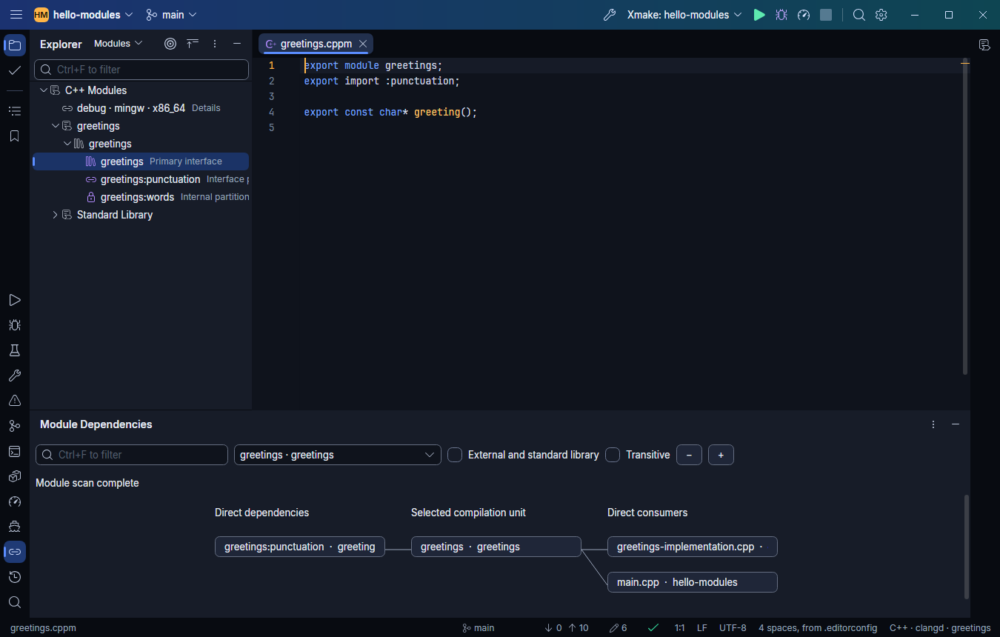

# Pitstop

Pitstop is an open-source, modules-first C and C++ IDE. It uses evaluated Xmake projects, clangd, and compiler dependency scans to show how named modules, partitions and targets fit together. Windows x64 is the reference platform, with native validation for C and for C++23 and C++26.



[View the same workspace in the light theme](docs/screenshots/module-graph-light.png).

[Native welcome screen](docs/screenshots/native-welcome-dark.png) · [New Project preview](docs/screenshots/native-wizard-dark.png) · [Hello Modules in Project Explorer](docs/screenshots/native-explorer-dark.png)

## Windows setup

The reference profile uses Windows x64, Xmake and Xrepo 3.1.2, LLVM-MinGW 23.1.6 with libc++, and clangd and clang-scan-deps 23.1.6. Install the tools separately and put the Xmake and LLVM `bin` directories on `PATH`. You can set `PITSTOP_XMAKE`, `PITSTOP_CLANGD`, and `PITSTOP_CLANG_SCAN_DEPS` to full executable paths instead. Set these variables before starting Pitstop. [Toolchain validation and setup](docs/architecture/cpp-toolchain.md)

Open **Settings → Native Toolchains** to check tool versions and enter explicit paths. Xmake selects the build compiler and SDK for each project.

The Windows installer is `Pitstop-windows-x64.exe`. The portable package is `Pitstop-windows-x64-portable.zip`. Extract the entire ZIP and run `Pitstop.exe` from its `Pitstop` folder. Create a `pitstop-data` folder beside `Pitstop.exe` to keep state with the portable copy. The [Releases page](https://github.com/jancano/pitstop/releases) is the location for published builds. Until a release is published, build the candidate locally using the packaging command in the build section below.

## Quick start

Choose **New Project** from the welcome screen or **File → New Project**. Pick an Xmake template and a compiler-verified language standard. Review the generated files, then create the project in a new directory. Pitstop opens the generated folder through normal workspace trust. For the Windows reference toolchain, configure the new project with the documented Xmake options if Xmake cannot select the toolchain on its own. [Native project setup](docs/architecture/xmake-workspaces.md) · [Local templates](docs/templates/authoring.md)

1. Configure the [Hello Modules example](examples/hello-modules) with the reference tools. Open the folder containing its `xmake.lua` in Pitstop and grant trust after reviewing the script.
2. Select **Xmake: hello-modules** in the toolbar and choose **Build** or **Run**. The executable prints `Hello, modules!`.
3. Open **View → Show Modules in Explorer** and **View → Module Dependencies**. Open `greetings.cppm` and invoke completion after `export import :` to see its interface partition.

## What Pitstop supports

- Xmake targets, source membership, dependencies, and active build configuration in the Explorer.
- clangd completion, diagnostics, hover, navigation, reference search, and formatting. Saved interface changes trigger semantic recovery with open buffers preserved.
- A Module Explorer and dependency graph built from compiler evidence. Follow providers, navigate partitions, inspect direct consumers and potential transitive impact, and create module source files with an editable Xmake membership suggestion when needed.
- Native build, rebuild, clean, cancellation, and run with compiler diagnostics, executable arguments, environment, working directory, console input and output, stop, and rerun.
- An HTTP client for workspace request files. Use **Tools → Endpoints** to send requests from `.http` or `.rest` files and inspect responses. **Generate Requests from OpenAPI** adds requests from an open OpenAPI JSON document so you can review and send them from the editor.
- Optional Discord Rich Presence. Set `PITSTOP_DISCORD_APPLICATION_ID` to a Discord application's numeric ID and choose in **Settings → Discord** whether to include workspace or file names. [Application and asset setup](docs/architecture/codebase-consolidation.md#discord-rich-presence).
- Read-only module intelligence for MCP clients. Enable MCP in Pitstop and configure a client to run `Pitstop.exe --mcp-attach`. The `module_workspace` tool queries the current trusted snapshot and accepts optional module name, target and result limit filters.

The editor, Git, terminal and shared debugger infrastructure come from Passenger. See the [Passenger repository](https://github.com/Zaneris/passenger) and the architecture guides for [Xmake](docs/architecture/xmake-workspaces.md), [clangd](docs/architecture/cpp-language-intelligence.md), [Build and Run](docs/architecture/native-build-run.md), and [module intelligence](docs/architecture/module-intelligence.md).

## Known limitations and roadmap

Native debugging and the Xrepo package installation UI are future work. The alpha validates the reference Windows x64 profile. Other Windows toolchains and Linux and macOS native workflows remain unverified. Unsaved edits remain in the editor, but propagation of unsaved changes between C++ modules is unverified. The module index reports missing and ambiguous dependencies, and P1689 leaves some implementation-unit relationships and re-exports unknown. The graph's potential impact shows dependency reachability. Xmake controls which units actually rebuild.

Report problems with the Pitstop version, toolchain versions, and a small reproducer in [GitHub Issues](https://github.com/jancano/pitstop/issues).

## Build and run

Install the .NET 11 SDK specified in [`global.json`](global.json), [just](https://github.com/casey/just), and Git. On Linux, install X11 and fontconfig libraries. Tests also use Python 3 and the .NET 10 SDK. Web language and container tests use Node.js and a Linux container engine, respectively.

```sh
just build                  # Debug build of Pitstop.slnx
just run                    # Open Pitstop
just test [FILTER]          # Run the test suite or matching tests
just screenshot pitstop.png # Render the window off-screen
```

The app is built under `artifacts/bin/Pitstop.App/debug/`. Run `Pitstop.exe` on Windows or `Pitstop` on macOS and Linux. Use `AVALONIA_TELEMETRY_OPTOUT=1` for builds outside `just`, including IDE builds.

To build the Windows candidate packages without a tag, run `just package-win win-x64` with `PITSTOP_RELEASE_VERSION=0.3.0-alpha.1` in the environment. The two packages are written to `artifacts/package/`. Set `PITSTOP_PACKAGE_DIRECTORY` to use a different directory under `artifacts/`. See the [alpha release notes](docs/release-notes/0.3.0-alpha.1.md) for verification and checksums.

## Application data

| Platform | Default data directory |
| --- | --- |
| Windows | `%LOCALAPPDATA%\Pitstop` |
| macOS | `~/Library/Application Support/Pitstop` |
| Linux | `$XDG_DATA_HOME/Pitstop` or `~/.local/share/Pitstop` |

`PITSTOP_SETTINGS` selects a different state directory. A `pitstop-data` directory beside a portable copy provides portable state. Settings, workspace state, cache and logs live under that root. The main log is `logs/pitstop.log`. Pitstop uses its own temporary directories and IPC names, and starts with its own workspace trust decisions.

CI builds and checks packages. Automatic application updates, release publishing, package registry publishing, and website deployment are disabled.

## Contribute

See [AGENTS.md](AGENTS.md) for repository conventions, [CLAUDE.md](CLAUDE.md) for architecture and testing details, and [CONTRIBUTING.md](CONTRIBUTING.md) for contribution guidance.

## License

Pitstop is distributed under the [MIT License](LICENSE). The original Passenger copyright and [third-party notices](THIRD_PARTY_NOTICES.md) accompany the source and builds.
